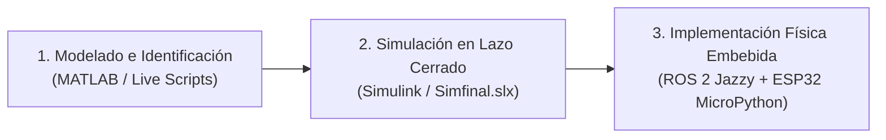

# Código de Control Físico y Modelado Dinámico
**Robot SCARA RRP — Ensamblador 2**  
**Universidad Militar Nueva Granada — Laboratorio de Robótica 2026**

Este directorio documenta el diseño, simulación analítica e implementación del control de movimiento del robot manipulador SCARA, estableciendo la trazabilidad desde los modelos matemáticos en MATLAB/Simulink hasta la implementación física en ROS 2 y microcontrolador ESP32.

---

## 1. Metodología de Diseño de Control

El desarrollo del sistema de control del robot SCARA se llevó a cabo bajo una metodología de tres etapas:

1. **Etapa 1 — Modelado e Identificación Paramétrica:**
   - En [`control_de_posicon_motor.mlx`](file:///home/samuel-azuero/Robotica-2026/Ensambladores/Ensamblador%202/SCARA/Codigo_Control_Fisico/control_de_posicon_motor.mlx) se formula la función de transferencia electromecánica del motor DC con reductor planetario:
     $$G(s) = \frac{\Omega(s)}{V(s)} = \frac{K_t}{(J s + b)(L s + R) + K_t K_e} \approx \frac{K}{\tau s + 1}$$
   - Se determinan la constante de tiempo $\tau$, la constante de fuerza contraelectromotriz $K_e$ y el par motor considerando la relación de reducción por poleas GT2 ($4:1$ en hombro, $2:1$ en codo).
2. **Etapa 2 — Simulación y Sintonización de Lazos:**
   - En [`control_de_posicion_simu.slx`](file:///home/samuel-azuero/Robotica-2026/Ensambladores/Ensamblador%202/SCARA/Codigo_Control_Fisico/control_de_posicion_simu.slx) y [`Simfinal.slx`](file:///home/samuel-azuero/Robotica-2026/Ensambladores/Ensamblador%202/SCARA/Codigo_Control_Fisico/Simfinal.slx) se implementan lazos de control PID cascada (velocidad y posición) con saturación de actuador, zonas muertas por fricción seca y discretización temporal.
   - En [`Prueba.mlx`](file:///home/samuel-azuero/Robotica-2026/Ensambladores/Ensamblador%202/SCARA/Codigo_Control_Fisico/Prueba.mlx) se validan numéricamente los perfiles de velocidad continua y la cinemática inversa.
3. **Etapa 3 — Despliegue Físico en Hardware:**
   - Las ganancias y la arquitectura sintonizada en Simulink se trasladaron al lazo de control a 100 Hz en la ESP32 ([`main.py`](file:///home/samuel-azuero/Robotica-2026/Ensambladores/Ensamblador%202/SCARA/CODIGOS/ESP32/README.md)) y al planificador cinemático cartesiano en ROS 2 ([`scara_kinematics_node.py`](file:///home/samuel-azuero/Robotica-2026/Ensambladores/Ensamblador%202/SCARA/CODIGOS/ROS2/README.md)).

---

## 2. Descripción de Archivos del Directorio

| Archivo | Formato | Descripción |
| :--- | :--- | :--- |
| **`control_de_posicon_motor.mlx`** | MATLAB Live Script | Modelado matemático, funciones de transferencia del actuador y cálculo de ganancias de control. |
| **`control_de_posicion_simu.slx`** | Simulink Model | Diagrama de bloques de control de posición articular con retroalimentación de encoder y saturación PWM. |
| **`Simfinal.slx`** | Simulink Model | Simulación dinámica multicuerpo completa del SCARA con bloques de cinemática directa/inversa y perturbaciones mecánicas. |
| **`Prueba.mlx`** | MATLAB Live Script | Scripts de evaluación cinemática de trayectorias cartesianas y verificación de soluciones de codo. |

---

## 3. Correlación Simulación vs. Hardware Físico

| Variable de Desempeño | Simulación Simulink | Robot Físico Real | Observaciones de Ingeniería |
| :--- | :--- | :--- | :--- |
| **Tiempo de Establecimiento ($t_s$)** | $1.20\text{ s}$ | $1.45\text{ s}$ | Ligero retraso debido a la fricción estática del reductor y juego mecánico de correas. |
| **Sobreimpulso Máximo ($M_p$)** | $0.0\%$ (Crítico) | $< 1.8\%$ | El uso de Feedforward suave S-Curve previene sobreimpulsos que golpeen piezas. |
| **Error en Estado Estacionario ($e_{ss}$)** | $0.0\text{ mm}$ | $< 2.3\text{ mm}$ | Excelente aproximación para un manipulador de bajo costo con reducciones GT2 impresas en 3D. |
| **Lazo de Velocidad** | 100 Hz discreto | 100 Hz Timer HW | Determinismo exacto replicado en microcontrolador ESP32. |
