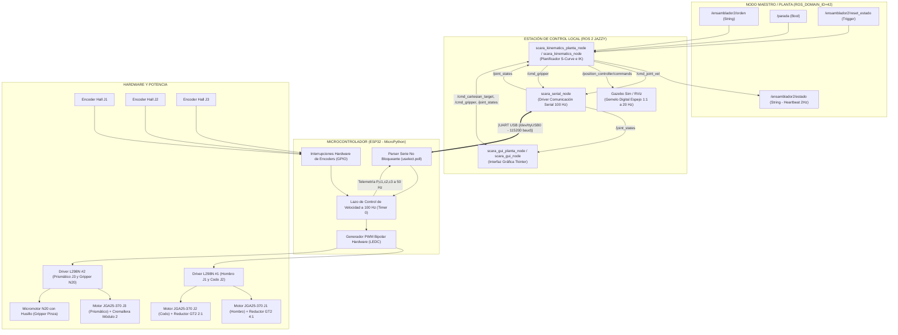
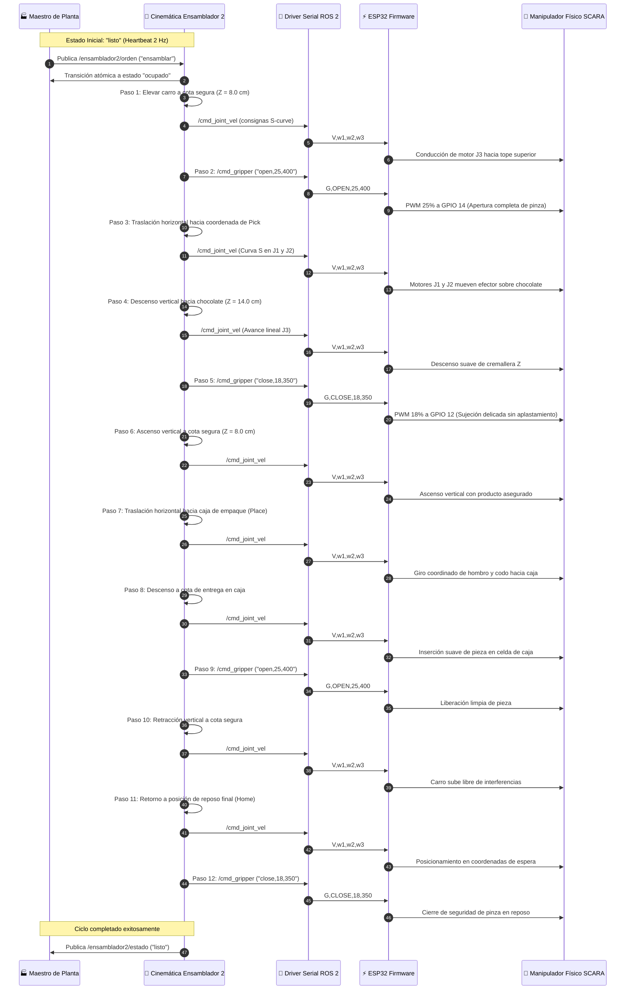
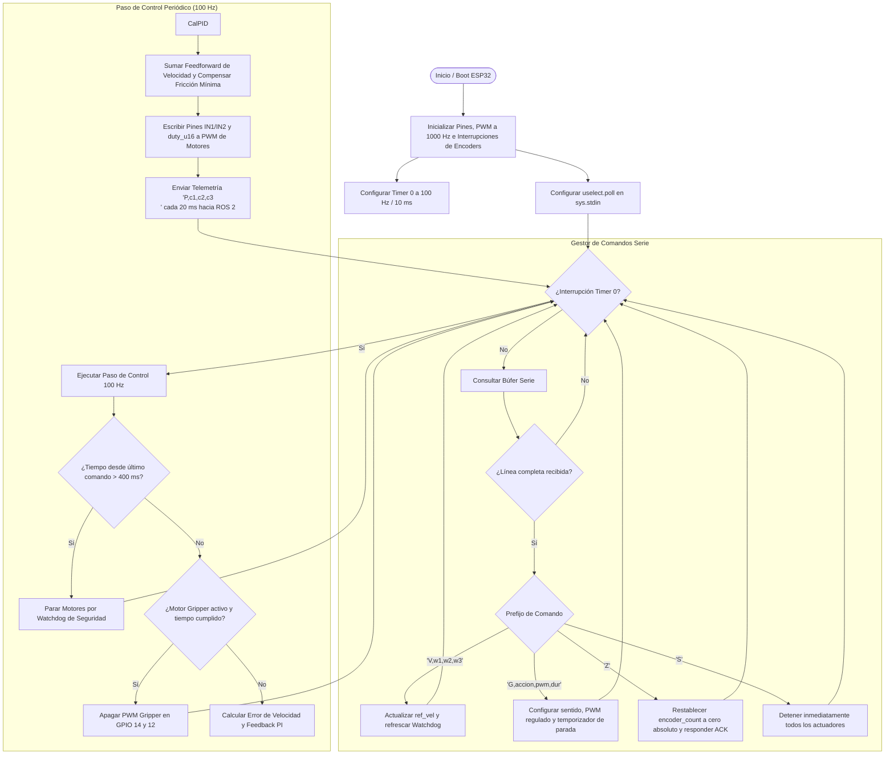

# Diagramas del Sistema — Robot Manipulador SCARA (Ensamblador 2)
**Universidad Militar Nueva Granada — Laboratorio de Robótica**  
**Equipo de Trabajo — Grupo #3 (Ensamblador 2)**

Este documento consolida los diagramas de arquitectura, flujo de control, secuencia de procesos y cableado eléctrico del sistema robótico.

---

## 1. Arquitectura General del Sistema

El sistema implementa una arquitectura distribuida de tres capas:
1. **Capa de Supervisión y Coordinación (Planta / Maestro):** Gestión de estados de la celda de empaque mediante tópicos estándar de ROS 2.
2. **Capa de Control Cinemático y Visualización (PC de Control / ROS 2):** Planificación cartesiana, cinemática inversa, telemetría y GUI.
3. **Capa de Ejecución de Bajo Nivel y Potencia (ESP32 / Drivers / Actuadores):** Lazo de control PI a 100 Hz, interrupciones de encoders y modulación PWM.

---

## 2. Diagrama de Secuencia del Proceso Pick & Place y Sincronización con la Planta

---

## 3. Diagrama de Flujo de la Lógica de Control en ESP32

---

## 4. Diagrama Esquemático de Conexiones Eléctricas

| Componente | Pin / Señal | Conexión en ESP32 / Sistema | Función / Nivel Lógico |
| :--- | :--- | :--- | :--- |
| **L298N #1** | ENA (PWM) | **GPIO 27** | Velocidad Hombro ($J_1$) - PWM 1000 Hz |
| | IN1 | **GPIO 25** | Sentido Giro Hombro ($J_1$) |
| | IN2 | **GPIO 26** | Sentido Giro Hombro ($J_1$) |
| | ENB (PWM) | **GPIO 23** | Velocidad Codo ($J_2$) - PWM 1000 Hz |
| | IN3 | **GPIO 33** | Sentido Giro Codo ($J_2$) |
| | IN4 | **GPIO 32** | Sentido Giro Codo ($J_2$) |
| **L298N #2** | ENA (PWM) | **GPIO 13** | Velocidad Prismático ($J_3$) - PWM 1000 Hz |
| | IN1 | **GPIO 16** | Sentido Giro Prismático ($J_3$) |
| | IN2 | **GPIO 17** | Sentido Giro Prismático ($J_3$) |
| | ENB (Puente) | Puente a 5V | Habilitación permanente canal B |
| | IN3 | **GPIO 14** (PWM) | Apertura Gripper N20 (PWM regulado $\le 25\%$) |
| | IN4 | **GPIO 12** (PWM) | Cierre Gripper N20 (PWM regulado $\le 18\%$) |
| **Encoders** | M1 ENC A | **GPIO 18** (Pull-Up) | Canal A Hombro (Interrupción de hardware) |
| | M1 ENC B | **GPIO 19** (Pull-Up) | Canal B Hombro (Dirección de cuadratura) |
| | M2 ENC A | **GPIO 21** (Pull-Up) | Canal A Codo (Interrupción de hardware) |
| | M2 ENC B | **GPIO 22** (Pull-Up) | Canal B Codo (Dirección de cuadratura) |
| | M3 ENC A | **GPIO 34** (Input-Only)| Canal A Prismático (Interrupción de hardware) |
| | M3 ENC B | **GPIO 35** (Input-Only)| Canal B Prismático (Dirección de cuadratura) |
| **Alimentación** | GND | **GND común** | Masa unificada (Fuente 12V + ESP32 + L298Ns) |
| | +12V DC | Bornes $V_s$ L298N #1 y #2 | Potencia de motores |
| | +5V DC | Vin ESP32 y $V_{ss}$ L298N | Alimentación lógica y sensores Hall |
