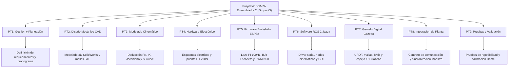

# Planeador On-Line de Gestión de Proyecto — Grupo #3 (Ensamblador 2)
**Universidad Militar Nueva Granada — Facultad de Ingeniería**  
**Programa de Ingeniería Mecatrónica — Laboratorio de Robótica 2026**  
**Herramienta de Gestión:** Notion Workspace (`Grupo #3 - Laboratorio de robótica - Ensamblador n°2`)  
**Enlace Notion:** [Grupo #3 — Ensamblador 2](https://app.notion.com/p/Grupo-3-Laboratorio-de-robotica-Ensamblador-n-2-3ed4dc0b7dd68055acd8e9a23afeeb36?source=copy_link)

---

## 1. Ficha Técnica y Gobernanza del Proyecto

| Campo | Detalle Institucional |
| :--- | :--- |
| **Proyecto** | Diseño, Construcción, Control e Integración de Celda de Manufactura — Robot SCARA (Ensamblador 2) |
| **Materia** | Laboratorio de Robótica |
| **Puesto en Celda** | **Ensamblador 2** (Recolección y encajonado ordenado de chocolates) |
| **Equipo de Trabajo** | **Grupo #3** |
| **Integrantes y Roles** | • **Samuel David Azuero Forero:** Líder de Diseño Mecánico y Cinemática • **Dilhann Adrián Yañez Nieves:** Líder de Montaje Eléctrico, Potencia e Integración Física • **Ana María Iglesias Roa:** Líder de Control Articular, Firmware y Sintonización PI • **Julian Camilo Paez Colmenares:** Líder de Software ROS 2, Gemelo Digital y Contrato de Planta |
| **Horizontes Temporales** | Febrero 2026 — Noviembre 2026 |
| **Estado General** | **100% Completado y Validado Experimentalmente** |

---

## 2. Objetivos del Proyecto

### 2.1. Objetivo General
Diseñar, implementar y validar experimentalmente un robot manipulador de configuración cinemática SCARA RRP para el puesto de **Ensamblador 2**, integrándolo a una celda de empaque automatizada bajo el middleware ROS 2 Jazzy, garantizando repetibilidad milimétrica ($< 2.3\text{ mm}$), agarre no destructivo de piezas y cumplimiento estricto del protocolo de comunicación con el nodo Maestro de la planta.

### 2.2. Objetivos Específicos
1. **Modelar y Desarrollar la Estructura Mecánica y Cinemática:** Diseñar en SolidWorks los eslabones $L_1$ ($205\text{ mm}$), $L_2$ ($130\text{ mm}$) y el mecanismo prismático $Z$ ($150\text{ mm}$ de carrera física), resolviendo analíticamente los modelos cinemáticos directo e inverso con selección determinista de configuración de codo.
2. **Implementar el Sistema Embebido y la Electrónica de Potencia:** Configurar la unidad ESP32 y drivers puente H L298N para el control de tres motores JGA25-370 con lectura de encoders de cuadratura a 990 pulsos/rev y la regulación segura por PWM del micromotor N20 del efector final a menos de 3.0V DC.
3. **Desarrollar la Arquitectura de Software en ROS 2 Jazzy:** Programar los paquetes modulares `scara_control` y `ENSAMBLE`, incorporando comunicación serie a 100 Hz, generador de trayectorias suaves en S (Minimum Jerk), control Feedback PI + Feedforward y gemelo digital en Gazebo/RViz.
4. **Integrar y Validar el Robot en la Celda de Empaque:** Implementar el contrato de comunicación de planta en el tópico `/ensamblador2/orden`, publicando heartbeat a 2 Hz en `/ensamblador2/estado`, respuesta a paradas de emergencia en `/parada` y ejecutando ciclos continuos de Pick & Place con cero acumulación de error.

---

## 3. Estructura de Desglose de Trabajo (WBS / EDT)

---

## 4. Cronograma de Actividades, Horizontes de Tiempo y Responsables

| Código | Paquete de Trabajo / Actividad | Fecha Inicio | Fecha Fin | Responsable Principal | Recursos Asignados | Estado | Entregable Asociado |
| :--- | :--- | :--- | :--- | :--- | :--- | :--- | :--- |
| **PT1.1** | Formulación de requisitos y actas de constitución | 05/08/2026 | 18/08/2026 | Todo el Equipo | Computadores, Notion, Normas | Completado | Acta de constitución y WBS |
| **PT2.1** | Diseño CAD de eslabones $L_1$ ($205\text{ mm}$) y $L_2$ ($130\text{ mm}$) | 19/08/2026 | 02/09/2026 | Samuel Azuero | SolidWorks, Calibrador, CAD | Completado | Planos mecánicos y STLs |
| **PT2.2** | Diseño del sistema prismático Z y pinza N20 | 03/09/2026 | 16/09/2026 | Samuel Azuero | SolidWorks, Impresora 3D, PETG | Completado | Ensamble físico eje Z |
| **PT3.1** | Deducción matemática de cinemática directa e inversa | 10/09/2026 | 24/09/2026 | Samuel / Ana María | MATLAB, LaTeX, Apuntes | Completado | `MEMORIAS_CALCULO.md` |
| **PT3.2** | Planificación de trayectoria S-Curve y cálculo de tiempos | 25/09/2026 | 08/10/2026 | Ana María Iglesias | Python, MATLAB Live Scripts | Completado | Algoritmo Minimum Jerk |
| **PT4.1** | Diseño de esquemático y distribución eléctrica | 15/09/2026 | 30/09/2026 | Dilhann Yañez | Proteus, Multímetro, Fuente 12V | Completado | `PLANOS ELECTRICOS.pdf` |
| **PT4.2** | Montaje de drivers L298N y cableado de encoders | 01/10/2026 | 14/10/2026 | Dilhann Yañez | Soldador, Cables, ESP32, L298N | Completado | Circuito montado en chasis |
| **PT4.3** | Acondicionamiento y protección de pinza N20 (3V) | 15/10/2026 | 22/10/2026 | Dilhann Yañez | Osciloscopio, Diodos, L298N | Completado | Etapa de potencia N20 |
| **PT5.1** | Firmware MicroPython: ISR de encoders y telemetría | 05/10/2026 | 19/10/2026 | Ana María Iglesias | ESP32, Thonny, MicroPython | Completado | `main.py` (ISR cuadratura) |
| **PT5.2** | Implementación del lazo de velocidad PI a 100 Hz | 20/10/2026 | 28/10/2026 | Ana María Iglesias | ESP32, Sensores Hall, Motores | Completado | Control PI con Feedforward |
| **PT6.1** | Creación del paquete ROS 2 `scara_control` y driver serial | 22/10/2026 | 02/11/2026 | Julian Paez | ROS 2 Jazzy, Ubuntu 24.04 | Completado | `scara_serial_node.py` |
| **PT6.2** | Desarrollo de nodo cinemático y rutina Pick & Place | 03/11/2026 | 10/11/2026 | Julian / Samuel | ROS 2 Jazzy, Python rclpy | Completado | `scara_kinematics_node.py` |
| **PT6.3** | Desarrollo de interfaces gráficas Tkinter (Local y Planta) | 08/11/2026 | 14/11/2026 | Julian Paez | Tkinter, Python, ROS 2 | Completado | `scara_gui_node.py` |
| **PT7.1** | Generación de URDF, mallas STL y configuración RViz | 15/10/2026 | 30/10/2026 | Julian Paez | SolidWorks URDF Exporter, RViz| Completado | Paquete `ENSAMBLE` |
| **PT7.2** | Integración del gemelo digital en Gazebo Sim (20 Hz) | 01/11/2026 | 12/11/2026 | Julian Paez | Gazebo, ros2_control | Completado | `gazebo.launch.py` |
| **PT8.1** | Implementación del contrato de comunicación de planta | 12/11/2026 | 16/11/2026 | Julian / Dilhann | ROS 2 Domain 42, FastDDS | Completado | `scara_kinematics_planta` |
| **PT8.2** | Desarrollo del simulador del nodo maestro de pruebas | 15/11/2026 | 18/11/2026 | Julian Paez | Python, ROS 2 topics | Completado | `simulador_maestro.py` |
| **PT9.1** | Pruebas de repetibilidad milimétrica y cero acumulación | 18/11/2026 | 20/11/2026 | Todo el Equipo | Robot real, Calibrador, Cámara | Completado | Deriva residual $< 2.3\text{ mm}$ |
| **PT9.2** | Consolidación del repositorio GitHub y planeador Notion | 20/11/2026 | 22/11/2026 | Todo el Equipo | GitHub, Notion, Markdown | Completado | Repositorio y Notion al 100% |

---

## 5. Asignación Exhaustiva de Recursos

### 5.1. Recursos Físicos y Hardware
- **1x Microcontrolador ESP32 NodeMCU-32S** (Frecuencia 240 MHz, conectividad UART USB).
- **3x Motores DC con reductor planetario JGA25-370 (12V, 60 RPM)** con encoders magnéticos de efecto Hall en cuadratura (990 ticks/rev).
- **1x Micromotor N20 (3V DC)** con husillo M3 y pinza paralela para agarre no destructivo.
- **2x Módulos Puente H Doble L298N** (2A por canal, disipador térmico de aluminio).
- **1x Fuente de Alimentación Conmutada 12V DC / 10A** para bus de potencia de motores.
- **Transmisiones Síncronas:** 2 correas dentadas GT2 de $6\text{ mm}$, poleas de aluminio de 20 dientes, polea conducida de 80 dientes (J1) y polea de 40 dientes (J2).
- **Sistema de Desplazamiento Lineal Z:** Piñón módulo 2 de 20 dientes, cremallera módulo 2 de $150\text{ mm}$, 2 varillas rectificadas de $8\text{ mm}$ y bujes LM8UU.
- **Estructura Portante:** Piezas impresas en 3D en filamentos PETG y PLA de alta densidad ($\approx 1.2\text{ kg}$).

### 5.2. Recursos Lógicos y Software
- **Sistema Operativo:** Linux Ubuntu 24.04 LTS (Noble Numbat).
- **Middleware:** ROS 2 Jazzy Jalisco con paquetes `rclpy`, `sensor_msgs`, `std_msgs`, `geometry_msgs`, `std_srvs`.
- **Entorno de Simulación:** Gazebo Harmonic / Classic + RViz 2.
- **Software CAD:** SolidWorks 2024 (Modelado paramétrico y ensambles con cinemática).
- **Software de Cálculo y Simulación:** MATLAB R2024b / Simulink (Lazos de control e identificación).
- **Gestión de Versiones y Documentación:** Git, GitHub (`angelaAceroh/Robotica-2026`) y Notion Workspace.

### 5.3. Recursos Financieros y Presupuesto Detallado

| Ítem / Concepto | Cantidad | Costo Unitario (COP) | Costo Total (COP) | Fuente de Financiación |
| :--- | :--- | :--- | :--- | :--- |
| Motores JGA25-370 con encoder Hall | 3 | $45.000 | $135.000 | Recursos propios Grupo #3 |
| Placa Microcontrolador ESP32 NodeMCU | 1 | $28.000 | $28.000 | Recursos propios Grupo #3 |
| Drivers Puente H L298N | 2 | $15.000 | $30.000 | Recursos propios Grupo #3 |
| Micromotor N20 con husillo para Gripper | 1 | $22.000 | $22.000 | Recursos propios Grupo #3 |
| Filamento PETG / PLA para impresión 3D | 1.5 kg | $80.000 | $120.000 | Recursos propios Grupo #3 |
| Correas dentadas GT2 y poleas de aluminio | 1 kit | $35.000 | $35.000 | Recursos propios Grupo #3 |
| Varillas rectificadas y bujes lineales LM8UU | 1 kit | $25.000 | $25.000 | Recursos propios Grupo #3 |
| Tornillería M3/M4, cables y conectores | Lote | $20.000 | $20.000 | Recursos propios Grupo #3 |
| Fuente conmutada 12V 10A | 1 | $65.000 | $65.000 | Laboratorio UMNG / Préstamo |
| **TOTAL INVERSIÓN PROYECTO** | — | — | **$480.000 COP** | — |

### 5.4. Recursos Logísticos y Espacios de Trabajo
- Puesto asignado en el Laboratorio de Robótica (Mesa de trabajo de celda de manufactura y empaque).
- Estación de trabajo equipada con puerto USB, osciloscopio digital de banco y multímetro automotriz para mediciones de corriente y análisis de rizado PWM.

---

## 6. Matriz de Asignación de Responsabilidades (RACI)

**Convenciones:**
- **R (Responsible):** Quien realiza la actividad.
- **A (Accountable):** Quien aprueba y rinde cuentas.
- **C (Consulted):** Quien aporta información clave.
- **I (Informed):** Quien es informado del avance.

| Paquete de Trabajo / Módulo | Samuel Azuero | Dilhann Yañez | Ana María Iglesias | Julian Paez |
| :--- | :---: | :---: | :---: | :---: |
| **PT1: Gestión y WBS en Notion** | **C** | **C** | **A** | **R** |
| **PT2: Diseño CAD Estructural y Mallas** | **R / A** | **C** | **I** | **C** |
| **PT3: Deducción Cinemática Analítica** | **R** | **I** | **A** | **C** |
| **PT4: Esquema Eléctrico y Potencia L298N** | **C** | **R / A** | **C** | **I** |
| **PT5: Firmware MicroPython ESP32** | **I** | **C** | **R / A** | **C** |
| **PT6: Nodos ROS 2 y Driver Serial** | **C** | **I** | **C** | **R / A** |
| **PT7: Simulación URDF y Gazebo** | **C** | **I** | **I** | **R / A** |
| **PT8: Integración de Contrato de Planta** | **C** | **C** | **A** | **R** |
| **PT9: Pruebas Experimentales de Celda** | **R** | **R** | **A** | **R** |

---

## 7. Trazabilidad de Hitos y Evidencias de Cumplimiento

1. **Hito 1 — Ensamble Físico Completo:**
   - Estructura montada con eslabones $L_1=205\text{ mm}$, $L_2=130\text{ mm}$ y mecanismo prismático con carrera útil de $90\text{ mm}$ (carrera mecánica de $150\text{ mm}$).
2. **Hito 2 — Control Embebido Determinista:**
   - ESP32 ejecutando lectura de encoders por interrupción de hardware y control PI de velocidad a 100 Hz estables.
3. **Hito 3 — Cinemática y Trayectorias Suaves:**
   - Algoritmo analítico cerrado con selección de codo izquierdo ($\sigma = -1.0$) y generación S-Curve con velocidad Feedforward.
4. **Hito 4 — Repetibilidad Milimétrica Comprobada:**
   - Pruebas alternantes de ciclos punto A $\leftrightarrow$ punto B con dispersión máxima de $2.24\text{ mm}$ y cero acumulación de error tras $10+$ ciclos.
5. **Hito 5 — Integración de Planta (Ensamblador 2):**
   - Validación unitaria de contrato con `test_planta_contrato.py` superada al 100%: Heartbeat 2 Hz (`/ensamblador2/estado`), gestión de orden `"ensamblar"`, inmunidad a duplicados, parada de emergencia instantánea y rearme por servicio.
