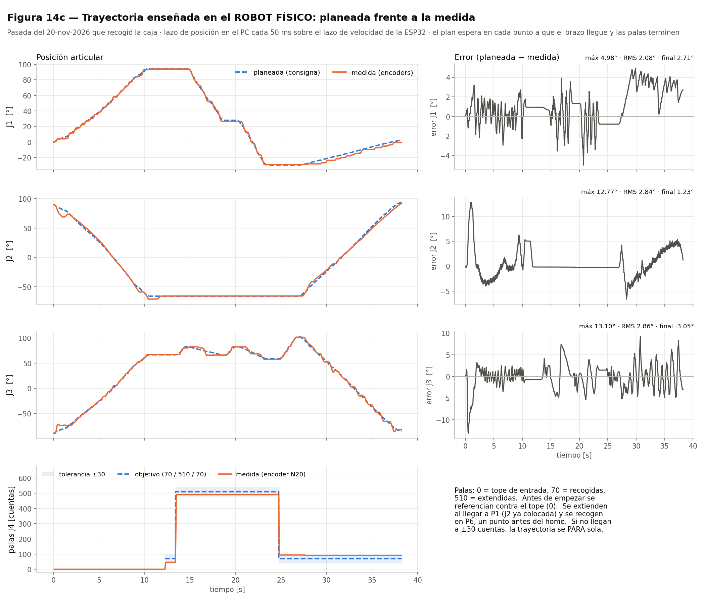

# Resultados

## Figuras — [`figuras/`](figuras)
| Figura | Qué muestra |
|---|---|
| `figura9a_gazebo_rviz_ciclo.png` | el modelo con el gripper definitivo en Gazebo y RViz, con la traza del TCP |
| `figura9b_trayectorias_en_rviz_y_gazebo.png` | ciclo de 14 puntos y trayectoria enseñada |
| `figura14a_ciclo14_planeada_vs_simulada.png` | ciclo de 14 puntos: planeada frente a simulada (Gazebo) |
| `figura14b_ensenada_planeada_vs_simulada.png` | trayectoria enseñada: planeada frente a simulada |
| `figura14c_ensenada_planeada_vs_robot_fisico.png` | trayectoria enseñada en el **robot físico**, con las palas |

## Error de seguimiento (planeada − real), en grados: máx / RMS
| Caso | J1 | J2 | J3 |
|---|---|---|---|
| Ciclo de 14 puntos, Gazebo | 3,76 / 1,26 | 8,52 / 2,13 | 14,73 / 4,19 |
| Trayectoria enseñada, Gazebo | 2,97 / 0,71 | 3,05 / 0,88 | 7,88 / 2,22 |
| Trayectoria enseñada, robot físico | 4,98 / 2,08 | 12,77 / 2,84 | 13,10 / 2,86 |

En todos los casos el error final es menor de 3,1°. Los picos aparecen al arrancar y
frenar cada tramo.

## Datos — [`datos/`](datos)
Los CSV de cada gráfica (tiempo, plan y medida por junta) y `metricas_error.txt`.

## Fotos — [`fotos/`](fotos)
El robot terminado.
